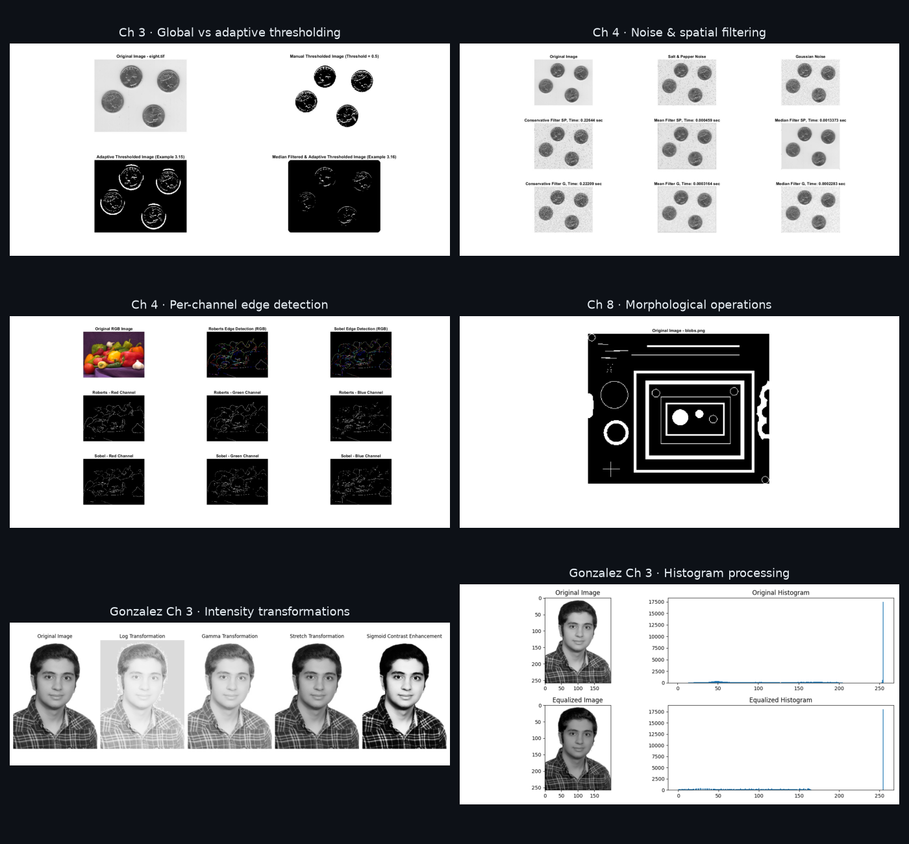

<div align="center">

# Digital Image Processing in MATLAB

**Worked examples, exercises and projects covering the core of digital image processing**

*Fundamentals of Computer Vision — Course Work, University of Kashan*
**Sina Mozaffari Rad** · Student ID 40021160214


</div>

---

Implementations of the worked examples and end-of-chapter exercises from two standard image-processing
textbooks, done chapter by chapter during the course. Each script reproduces or extends a technique and saves
its result figure.

<p align="center"></p>

## Contents

### *Fundamentals of Digital Image Processing* (Solomon & Breckon) → [`fundamentals-solomon-breckon/`](fundamentals-solomon-breckon)

| Chapter | Topic | Techniques implemented |
|---------|-------|------------------------|
| [**3**](fundamentals-solomon-breckon/ch03) | Pixels & point operations | Image arithmetic, logical ops, log / exponential / power-law transforms, histograms, histogram equalisation and matching, global vs adaptive thresholding · 8 exercises + examples |
| [**4**](fundamentals-solomon-breckon/ch04) | Enhancement & spatial filtering | Salt-and-pepper / Gaussian noise models, mean, median and conservative filters with timing comparison, Gaussian smoothing, motion blur and boundary handling, Laplacian sharpening, Roberts / Sobel edges per RGB channel · 11 exercises + examples |
| [**5**](fundamentals-solomon-breckon/ch05) | Fourier transforms | 2-D FFT, spectrum visualisation, frequency-domain filtering |
| [**6**](fundamentals-solomon-breckon/ch06) | Image restoration | PSF modelling, inverse filtering, Wiener (`deconvwnr`), regularised (`deconvreg`) and Lucy–Richardson (`deconvlucy`) deconvolution |
| [**7**](fundamentals-solomon-breckon/ch07) | Geometry | Procrustes shape alignment, control-point based projective registration (`cp2tform` / `imtransform`) |
| [**8**](fundamentals-solomon-breckon/ch08) | Morphological processing | Erosion and dilation with varying / decomposed structuring elements, opening, closing, hole filling, connected-component labelling · 5 exercises + examples |

### *Digital Image Processing Using MATLAB*, 3rd ed. (Gonzalez, Woods & Eddins) → [`dip-using-matlab-gonzalez/`](dip-using-matlab-gonzalez)

| Chapter | Content |
|---------|---------|
| [**3**: Intensity transformations & spatial filtering](dip-using-matlab-gonzalez/ch03) | All chapter examples (`Chapter3.m`) plus projects P3.1–P3.10 in MATLAB and Python: log / gamma / contrast-stretch / sigmoid transforms, global and local histogram equalisation, histogram specification, performance timing, linear and nonlinear spatial filtering, and a zone-plate filtering study |

The Gonzalez projects were solved on a personal portrait instead of the support-package images, and every
script works with any input image. P3.8 needs data files that exist only in the book's support package and is
documented as not solvable without them. See the [projects README](dip-using-matlab-gonzalez/ch03/projects/README.txt).

## Running

Each `.m` file runs on its own in MATLAB with the Image Processing Toolbox. Most scripts use the standard
toolbox demo images (`cameraman.tif`, `rice.png`, `coins.png`, `peppers.png`, …). The textbook-specific images are
not redistributed here. Download them from each book's companion website and place them next to the script.
The Python projects need `numpy`, `pillow` and `matplotlib`.

## Structure

```
fundamentals-solomon-breckon/
  ch03 … ch08/
    examples/             Worked examples from the chapter
    exercises/            End-of-chapter exercise solutions
      outputs/            Result figures
dip-using-matlab-gonzalez/
  ch03/
    examples/             Chapter examples (+ notes on numeric outputs)
    projects/             Projects P3.1–P3.10 (MATLAB / Python)
      outputs/
docs/                     README showcase figure and generator
```
